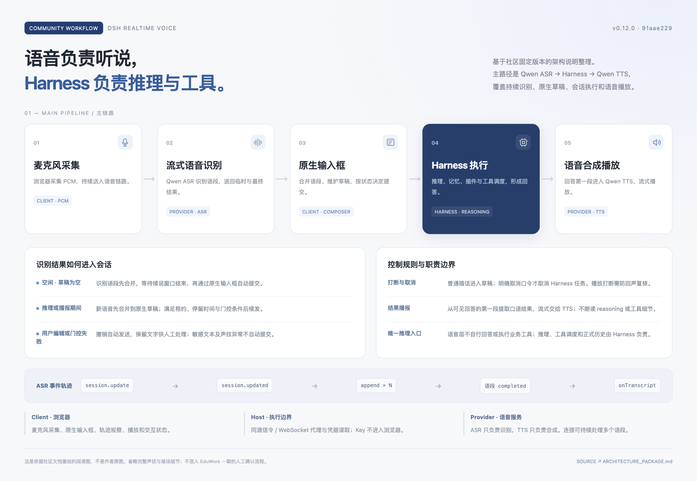
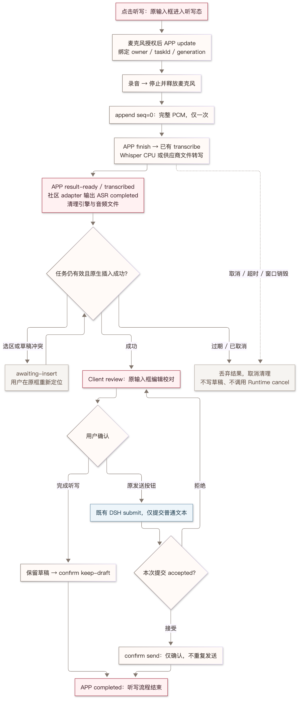
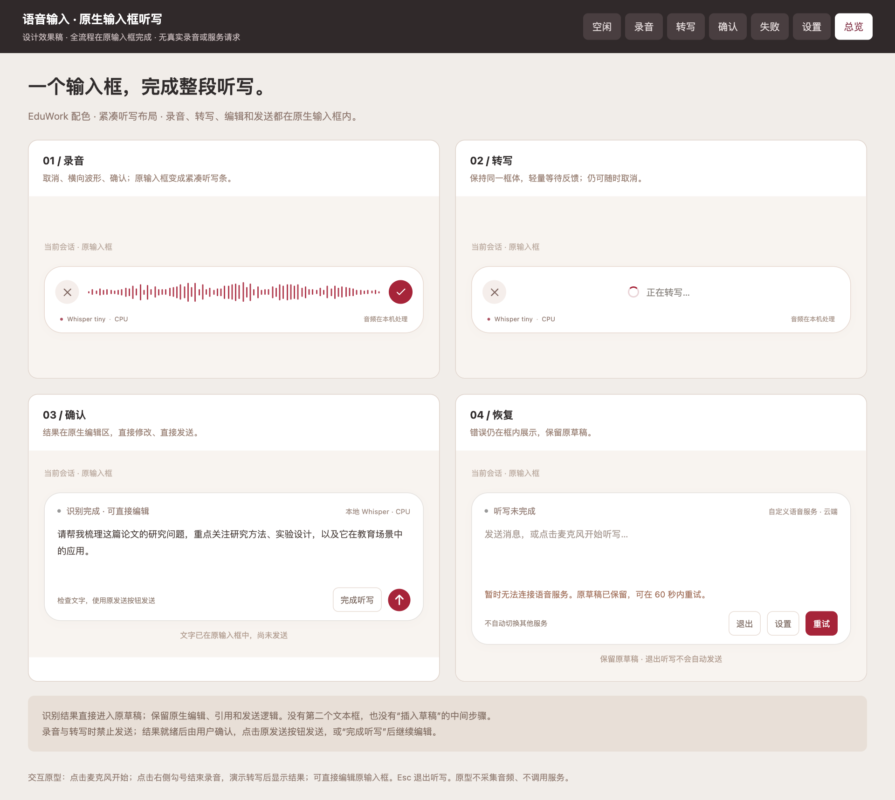

# 语音输入一期技术方案

状态：待评审，未实现。关联 [#146](https://github.com/ECNU/EduWork/issues/146)。

## 1. 实现边界

一期：点击听写 → 原输入框进入听写态 → 录音 → 转写 → 原编辑区校对 → 用户确认保留草稿或发送。

**APP 包办语音交互与 ASR 编排；DSH Agent Runtime 仍只接收普通文本。** 客户端需要增加原输入框听写态，不能因此把 ASR 任务、音频或确认状态引入 Runtime 的 Agent 会话协议。

| 层 | 职责与改动 |
| --- | --- |
| APP renderer / 客户端扩展 | 麦克风、原生输入框、听写 workflow 与用户确认。 |
| APP main / 受控执行侧 | 校验 IPC 调用者、管理识别任务、解析凭据、调用已有转写实现、取消与清理。 |
| 现有 ASR 能力 | 复用 `TranscriptionService.transcribe`、Whisper CPU 与文件转写供应商适配器；作为 backend 调用，不修改 DSH 的 ASR 算法。 |
| DSH 客户端输入组件 | 增加听写态、只读、提交门禁和原生插入事务；保留同一 Lexical 编辑器实例。 |
| DSH Agent Runtime | 保持原 `submit` 文本入口；不接收音频，不识别听写事件，不管理 ASR 任务。 |

现有 DSH 官方实验性服务也有 `speechToText.transcribe(spec, signal)` 和 `remote.speech.transcribe(...)`，均是一次性完整录音转写。它们是可选的既有 backend，不是本次需要新造的 Runtime 能力。桌面一期优先复用共享服务的独立库导出，直接在 APP 执行侧调用；以后若接官方服务，由 `DshTranscribeBackend` 封装现有调用，调用取消与断连一起归入 APP 任务，不新增 Runtime 协议。

一期默认本地 Whisper CPU；云端支持已配置的 OpenAI-compatible 文件转写。GPU、实时出字、翻译、TTS、自动发送后续扩展。公版不包含机构地址、模型默认值或凭据；本地失败不切换云端。

## 2. 统一 workflow 与社区兼容

社区兼容基线固定为 [`91aae229… / v0.12.0`](https://github.com/zfu691531-hash/dsh-realtime-voice/tree/91aae229357e647964bbf2e50ec7602c4ce55d4a)。保留其 Client 音频、Host 执行/凭据、ASR 识别和 Harness 推理的职责划分；在桌面产品中，Host 职责由 APP 受控执行侧承担。

### 一期就是单次 append 的 workflow

```text
session.update（固定配置、创建 APP 听写任务）
    → 录音
    → append(seq=0, 完整音频)
    → finish（封闭音频输入，调用现有 transcribe）
    → transcribed（识别完成，结果写入原编辑区）
    → 用户校对 / 修改
    → confirm
    → completed（APP 听写 workflow 完成）
```

`transcribe(audio)` 作为非流式便捷入口，内部等价于 `append(seq=0, audio) + finish()`；不成为绕开 workflow 的第二条业务链。`append` 保存有界音频，`finish` 才触发批量 backend；正常终止的 Promise 在结果返回时结束，不能等用户确认。

以后将 APP 一次 append 扩展为多次 append，并增加流式 backend 的 openStream、事件消费和背压；确认和原生输入框流程继续复用。不能仅增加 append 次数就宣称流式识别。

### 社区实际链路与一期实现图

社区原版的 ASR 是持续输入、按语段返回最终结果；语段 completed 可以发生多次，不需要先结束连接。`finish` 是连接收尾。下面分别画源码行为与本期实现，不能把 APP 的 confirm/completed 当成社区原有事件。

社区原文入口：[Discussion #2008](https://github.com/deepseek-ai/deepseek-harness/discussions/2008)、[固定版本架构契约](https://github.com/zfu691531-hash/dsh-realtime-voice/blob/91aae229357e647964bbf2e50ec7602c4ce55d4a/docs/ARCHITECTURE_PACKAGE.md)、[固定版本功能说明](https://github.com/zfu691531-hash/dsh-realtime-voice/blob/91aae229357e647964bbf2e50ec7602c4ce55d4a/README.md)。



[现代样式可编辑图稿](voice-input/workflow-modern.html)；这是按社区原文重绘的阅读图，包含 ASR → Harness → TTS。APP 人工确认的 workflow 是本期设计，不是社区原文已有流程。

[ASR 事件详细流程图](voice-input/community-workflow.png)

[社区流程图源文件](voice-input/community-workflow.mmd)。图中展开 Qwen 专用 ASR 路径，依据 `qwen-pipeline.ts` 的 openAsr/appendAsr/handleAsr 和 `controller.ts` 的 bufferTranscript；不是所有供应商的统一协议，也不包含完整声纹/打断细节。



[一期流程图源文件](voice-input/phase1-workflow.mmd)。一期执行路径只使用现有文件转写后端；社区 codec/回调适配负责输入输出映射，不额外建立一条实时供应商连接。

### 两种 completed 必须区分

| 事件 | 发生时机 | 归属 |
| --- | --- | --- |
| `conversation.item.input_audio_transcription.completed` | ASR 返回某语段最终识别文本时 | 社区 ASR 协议；此时不代表用户已确认。 |
| `transcribed` | APP 接收到完整识别结果，进入校对阶段 | APP workflow，映射上述社区最终结果。 |
| `completed` | 用户明确确认保留或发送后 | APP workflow；是我们的交互完成事件，不冒充社区识别事件。 |

不能把社区 `input_audio_transcription.completed` 延迟到用户确认后才发，否则消费者无法先取得识别文本进行校对。用户提出的“确认后 completed”落在 APP workflow 层，社区识别事件的字段和时序保持兼容。

### 兼容矩阵

| 社区契约 | APP 适配 |
| --- | --- |
| `VoiceConnection.connect/disconnect` | 对应任务准备与取消；正常收尾单独使用 `finish`，不把断开连接当成功。 |
| `RealtimeCallbacks.onState/onTranscript` | 保留状态、最终文字与可选 metadata 语义；不伪造声纹、speaking 或忙闲标签。 |
| `session.update` / `session.updated` | 校验并固定本次 Provider、语言和格式；返回已准备接收音频，不表示已开始识别。 |
| `input_audio_buffer.append` | 保留 PCM16 / 16 kHz / 单声道 / base64 音频语义；非流式可一次传全部 PCM，WAV 头由 backend 适配器添加或剥离。 |
| `session.finish` | 封闭输入，等待最终结果和资源收尾；不照搬固定 200 ms 关闭连接策略。 |
| `conversation.item.input_audio_transcription.completed` | 保留 `item_id/transcript`，映射 APP 的 `transcribed`，再交给原生编辑器。 |
| `speech_started/stopped`、临时结果 `text/stash` | 未来流式 backend 声明能力后启用；批量 backend 不制造这些事件。 |
| `error` | 保留错误结构，脱敏后进入 APP 失败态；不模拟识别成功。 |

`compat/community-v012/` 集中管理类型、codec 和回调适配；APP IPC 是消息载体。适配器把社区 update/append/finish 映射到同一 APP 任务，将识别结果映射为社区 completed 与 onTranscript；不修改事件含义。第一期交付消息/回调适配和契约用例，不宣称原版 WebSocket 客户端可直接连接 APP IPC。

APP 的“一次 append”是逻辑操作，不要求社区 WebSocket 传输也只能发一个巨型消息。120 秒 PCM 约 3.84 MB，base64 后约 5.12 MB，超过参考插件 WS 代理的 2 MiB 单消息限制。未来 transport adapter 必须将逻辑 append 拆为至多 32 KiB PCM 的消息，并按顺序封包；这属于传输分帧，不是流式识别。直接复用一次超大 WS append 不列为兼容实现。

社区 `QwenPipelineConnection.connect()` 同时打开 ASR 与 TTS；一期提取其 ASR 协议适配，不直接运行完整连接类。原版旧 HTTP/WS 路由和完整实时对话插件的无修改安装，不属于一期兼容承诺；后续增加 transport adapter 时独立验收。工具代理、TTS、自动发送不启用。

## 3. APP 接口与任务状态

以下为新增提案接口。原生 IPC 只传结构化数据，不传 `AbortSignal`、函数、Provider 实例或秘密。

```ts
// VoiceTaskRef 标识 APP 执行侧创建的一次听写任务。
interface VoiceTaskRef {
  readonly taskId: string;
  readonly generation: number;
}

// VoiceTaskConfig 固定一次 workflow 使用的非秘密配置。
interface VoiceTaskConfig {
  readonly protocolVersion: 1;
  readonly conversationId: string;
  readonly providerId: string;
  readonly language: string;
  readonly mode: 'recorded' | 'streaming';
}

// AudioAppend 表示完整录音或有序音频片段。
interface AudioAppend {
  readonly task: VoiceTaskRef;
  readonly seq: number;
  readonly format: 'pcm16-mono-16000';
  readonly audio: ArrayBuffer;
}

// Transcribed 是 finish 的结果，用户尚未确认。
interface Transcribed {
  readonly task: VoiceTaskRef;
  readonly type: 'transcribed';
  readonly text: string;
  readonly providerId: string;
  readonly execution: 'cpu' | 'gpu' | 'remote';
  readonly audioSeconds: number;
}

update(config: VoiceTaskConfig): Promise<VoiceTaskRef>;
append(request: AudioAppend): Promise<{ acceptedSeq: number }>;
finish(task: VoiceTaskRef): Promise<Transcribed>;
confirm(task: VoiceTaskRef, action: 'keep-draft' | 'send'): Promise<void>;
cancel(task: VoiceTaskRef): Promise<void>;
```

一期只声明 `mode: recorded`，只接受一次 `seq=0`。流式模式在后续能力协商通过后启用；不支持的 mode 明确报错。已有 `transcribe` 由内部 `RecordedBackend.finish()` 调用，不在 IPC 层重复暴露一套独立流程。

### 两层状态机

APP main 只记录执行任务和确认回执，不管理光标、选区或校对面板。renderer 独立管理呈现状态；不能要求 main 凭空判断一次原生插入是否成功。

| APP main 状态 | 接受的操作 | 下一状态与约束 |
| --- | --- | --- |
| `ready` | append / cancel | append 一次后 buffered。 |
| `buffered` | finish / cancel | finish 封闭输入并进入 transcribing。 |
| `transcribing` | cancel / 重复 finish | 重复 finish 共用同一结果 Promise，不重复推理或收费。 |
| `result-ready` | confirm / cancel / 重复 finish | 返回原识别结果；音频/引擎已释放，不占识别并发。 |
| `completed` | 重复同参数 confirm | 幂等成功；不调用 submit。 |
| `cancelled` / `failed` | cancel | 幂等清理；重试创建新 taskId。 |

| renderer 状态 | 进入条件 | 原输入框行为 |
| --- | --- | --- |
| `requesting` | 点击听写，正在授权/选择服务 | 原位展示听写状态，尚未创建 APP 任务；取消后释放迟到授权。 |
| `recording` / `transcribing` | APP 已 ready / finish 已发出 | 保留原文、临时只读、拦截发送。 |
| `awaiting-insert` | 结果有效但原生插入冲突 | 不覆盖原文；在原输入框重新定位后显式回填。 |
| `review` | 成功取得原生插入回执 | 同一编辑器校对；允许完成听写或正常提交。 |
| `submitting` | 用户明确点击原发送按钮 | 跟踪本次既有提交，阻止重复点击；拒绝则回 review。 |
| `idle` | 确认完成或取消 | 释放 lease，按原规则保留草稿。 |

- 取得麦克风授权后才 update 创建 APP 任务；update 成功前不开始录音，150 秒任务 TTL 不覆盖用户在系统授权弹窗停留的时间。取消期间迟到的 update 必须立即 cancel，不能遗留后台任务。
- 重复 append：同 seq 且字节一致返回原确认；同 seq 不同内容报冲突。结束后新 append 均拒绝。main 保存已接受音频的摘要，不为去重重复保留整份音频。
- `finish` 成功与 cancel 在 main 内串行提交状态；cancel 先发生则迟到结果丢弃，成功先发生则进入 result-ready。调用方仍需校验 renderer generation，不能只看 main 成功。
- main 在 result-ready 缓存有界的文字结果和元数据，以便重复 finish 返回同一结果；最长 15 分钟。清理音频与缓存识别文字是不同操作。完成/取消后释放文字，仅保留至多 60 秒的有界幂等回执。
- `confirm` 不负责调用 Agent。完成听写 → renderer 确认 keep-draft；发送 → renderer 调用原 submit，收到 accepted 才确认 send。rejected 保留 review/草稿。IPC 重试只重发确认，不重新 submit。
- 当前 `InputActions.submit()` 返回 void，因此客户端需要观测既有提交结果并携带本次提交 attempt 标识，不能把普通 phase 变化或任意用户消息当作本次发送成功；不修改 Runtime 提交协议。
- 如果 Runtime 已 accepted，但 APP confirm 回执失败，只重试 confirm/结束本地听写，不撤销已接受消息、不再次发送，也不调用 Runtime cancel。ASR 取消无权取消 Agent 任务。
- 空文本在 renderer 进入无语音提示，可重录或退出；main 仍处于 result-ready，不自动 completed、不创建空消息。

## 4. 任务所有权与取消

### APP 执行侧所有权

复用 `dsh-electron/src/native-desktop-bridge.mjs` 的主窗口/main-frame sender 校验，为听写增加独立处理器。owner 由 APP 从 IPC event 得到，不接受 renderer 自报的 windowId 作为授权。

```ts
// VoiceTaskOwner 来自已校验的 Electron 主框架调用上下文。
interface VoiceTaskOwner {
  readonly webContentsId: number;
  readonly navigationEpoch: number;
}

// VoiceTask 保存 APP 独占的执行资源；不进入 DSH Agent session。
interface VoiceTask {
  readonly owner: VoiceTaskOwner;
  readonly ref: VoiceTaskRef;
  readonly conversationId: string;
  readonly abort: AbortController;
  readonly provider: TranscriptionHandle;
  readonly directory: string;
}
```

- 每个主窗口同时一个听写 workflow；APP 同时最多两个识别任务。taskId 由 APP 随机生成，generation 防止旧操作复用；每个操作同时验证 sender、navigationEpoch 与 taskId。
- `conversationId` 只用于客户端路由和草稿归属，不作为 DSH 会话授权凭证；ASR 不读会话历史、不访问 Agent 工作区。编辑器再校验当前 conversationId 与 generation，防止写错草稿。
- 主框架刷新/导航递增 navigationEpoch；窗口销毁、renderer 崩溃、APP 退出时由 main 主动取消 owner 的任务。不能只依赖 renderer 最后发一次 cancel。
- 会话切换由客户端先撤销编辑器 lease、递增 generation、停麦，再发 cancel；即使 IPC 取消迟到，旧结果也不能写入新会话。

### 取消的具体动作

| 触发 | renderer | APP 执行侧 |
| --- | --- | --- |
| 录音/识别中 Esc / 取消 | 立即停麦、撤销本 generation 的写入资格、发 cancel | 标记取消，abort 请求/子进程，等待释放，清理任务目录。 |
| 停止录音 | 停麦，append 一次完整 PCM，再 finish | 执行已有 transcribe；正常等待结果，不触发 cancel。 |
| 窗口关闭/崩溃/刷新 | 设备随页面生命周期释放 | 根据 owner/navigationEpoch 主动 abort，无需等待 Client 通知。 |
| Provider 注销或配置替换 | 显示原任务不可用，不自动换服务 | 取消固定实例的在途任务；新任务显式使用新配置。 |
| 超时 | 撤销写入资格，保留原草稿 | abort 并清理；不将超时解释成无语音。 |
| review 退出 | 保留已写入的文字；退出听写态可按 keep-draft 确认 | 音频已释放，确认或取消都只结束剩余的 APP workflow。 |

共享转写库当前注销 Provider 只删除注册；本期增加固定实例 handle、在途调用集合和注册生命周期取消。APP 主进程持有 abort；经现有 provider 的 signal 终止本地子进程或 fetch，不把 signal 通过 IPC 序列化。

转写成功、失败、取消都清理整棵私有任务目录，包括 FFmpeg/Whisper 的转换音频和日志；已写入的原草稿不回滚。识别失败时 renderer 可显式保留音频最多 60 秒，重试用新 taskId；APP 不保留原任务以等待无限重试。

### 限制与凭据

- 录音上限 120 秒、原始 PCM 上限 4 MiB；进入 APP 时先验字节数、偶数字节与采样参数，WAV 头在适配器生成。调用既有 DSH WAV 接口时再做格式转换与校验。
- ready/buffered 空闲超时 150 秒，识别超时 120 秒；超时与取消共用清理路径，不因过期重新执行任务。main 的 result-ready 不占识别并发额度，最长保留 15 分钟；对应 renderer 的 awaiting-insert/review。过期只结束任务，不删除已写入草稿，并通知客户端释放听写 lease；此后发送走普通文本路径，不再确认过期任务。
- APP 执行侧逐请求解析凭据；复用现有 native vault/受控凭据边界，不在 preload 提供通用读 Key 能力。共享库通过 `getHeaders` 获得本次请求头，renderer 仅看 Provider 元数据。
- 在受信配置入口新增可选 `transcription.providers[]`，保存 id、type、baseURL、model、credentialRef；新增共享校验 schema，APP 与既有共享服务分别适配宿主、复用 schema 与 Provider 工厂。该列表与共享 schema 尚待实现，不表述为当前已有配置能力。
- provider 实例在 update 时固定，秘密在实际 finish 执行时解析。错误只返回代码、脱敏说明和 taskId，不记录音频、转写正文或秘密，不自动重试、不 fallback。

## 5. 代码改动

以下是计划文件，本轮只修改方案；不表示代码已经存在。

| 文件/目录 | 改动 |
| --- | --- |
| `packages/dsh-voice-input/src/client/controller.ts` | APP workflow、单次 append/finish、review/confirm、generation 和草稿归属。 |
| `packages/dsh-voice-input/src/client/recording.ts` | 录音、PCM16 编码、停止与取消、迟到授权释放。 |
| `packages/dsh-voice-input/src/client/VoiceInput.tsx` | 原输入框内部的录音、转写、错误和确认控件，不创建第二个编辑框。 |
| `packages/dsh-voice-input/src/client/ComposerPresentation.tsx` | 原输入框内的紧凑录音布局和模型标识，不创建遮罩或改变背景交互。 |
| `packages/dsh-voice-input/src/contracts.ts` | APP workflow 请求/事件、能力声明与错误码。 |
| `packages/dsh-voice-input/src/compat/community-v012/` | 社区 ASR 消息、回调与 APP workflow 的适配及来源记录。 |
| `dsh-electron/src/voice-input-service.mjs` | APP 任务表、owner、状态转换、并发、超时、取消、幂等与清理。 |
| `dsh-electron/src/voice-input-backends.mjs` | 复用共享转写库的 Provider 工厂与 transcribe，不注册新的 Runtime ASR 服务。 |
| `dsh-electron/src/native-desktop-bridge.mjs` | 注册受主框架校验保护的 ASR IPC，挂接导航/窗口销毁清理。 |
| `dsh-electron/src/preload-voice-input.cjs` | 窄接口桥接 update/append/finish/confirm/cancel；不公开任意文件、网络或凭据 API。 |
| 桌面 preload 组合、打包脚本及精确依赖锁 | 挂载 preload，随 APP 装配共享服务的锁定 npm 包及引擎资源；不依赖开发机 workspace 链接。 |
| `artifact-services/lib/transcription.js` | 固定实例、注册生命周期和取消能力；文件转写消费者继续使用原接口。 |
| 共享服务的新增配置 schema 与 APP 配置加载适配 | 一处校验 Provider 列表，两处宿主显式注册；不重复实现供应商请求。 |
| `scripts/patch-pinned-dsh-voice-input.mjs` | 仅适配 DSH 客户端输入组件，明确生成和装配修改后的客户端产物，记录源 SHA 与输出摘要。 |
| 对应包管理/发行清单 | 装配客户端扩展；检测重复官方听写 UI；不新增用户侧 skill。 |

`@eduwork/dsh-voice-input` 承载客户端扩展与契约；APP 执行能力由 Electron main 提供。DSH bundle 的 Host 半如为发现 Client 所需，仅做现有加载机制要求的入口，不注册 ASR 服务或新增 Runtime Remote。没有桌面桥的普通 Web 不假装可用；后续 Web adapter 通过同一 workflow 接现有转写接口，单独验收。

### 客户端输入框改动

| DSH 客户端文件 | 计划改动 |
| --- | --- |
| `client/contract/input.ts` | 增加 `beginDictation()`、`DictationLease` 和提交结果通知。 |
| `client/input/facade.ts` | 固定原会话与 TokenSpan；录音/转写时挡住提交；识别文字一次原生事务插入；观测既有提交 accepted/rejected。 |
| `client/skeleton/InputBar.tsx` 及样式 | 切换只读、框内控件和发送按钮，提供稳定框体引用，保留原编辑器实例。 |

这些路径均位于上游 `packages/client/ui-conversation/src/`。改动属于 APP 使用的 DSH 客户端，不修改 Agent、工具、会话事件或推理 Runtime。

客户端源码必须单独编译并接入 APP 的客户端资源装配，不能只修改未被消费的源码目录。开发时使用独立的客户端适配构建阶段和输出目录，固定输入 SHA、依赖锁、输出摘要；正式交付按批准后的客户端组件产物装配，不静默覆盖锁定 npm 包或全局缓存。这个构建改动只为交付客户端交互，不承担 ASR 实现。

## 6. UI 与确认语义

[交互效果稿](voice-input-ui.html) · [录音](voice-input-recording.png) · [确认](voice-input-review.png) · [状态总览](voice-input-states.png)。均为原型渲染，不是已实现截图。



- 点击听写后在当前输入框原位展示录音态，记录选区与插入锚点；不加遮罩、不提层高亮、不禁用背景会话。Esc/取消按钮退出，切会话仍撤销旧任务。识别完成进入校对时再将光标置于结果末尾。
- 录音和转写时保留原文、附件和引用，编辑区临时只读，禁止所有发送入口。录音采用 ChatGPT 听写风格的紧凑横条：左侧暖灰底圆形取消、中间 EduWork 红色音量波形、右侧品牌红底圆形勾号；取消大标题、红色波形、常驻计时及说明段落。既有草稿非空时仍在同一框内保留显示。
- 勾号仅表示停止录音并转写（finish），不代表确认发送或 APP completed；转写时复用同一框体，仅显示轻量等待反馈和取消。实际时长仍由采集侧与 APP 校验，接近上限时再提示。框内底部仅保留小号模型/CPU 或云端标识与音频去向说明，沿用 EduWork 暖白及红色风格。
- transcribed 后通过修订校验向同一 Lexical 编辑器插入一次，恢复原生编辑和发送；支持一次撤销，不调用 setDraft 覆盖整份文档。
- 原生插入因草稿变化失败时进入 awaiting-insert，不覆盖；缓存结果并在同一个输入框内提示重新定位回填，成功取得插入回执后再进入 review。
- 校对完成：点击原发送按钮走既有提交；或“完成听写”确认 keep-draft，只结束听写态。两者都由用户触发，才产生 APP completed；不自动调用 Agent。
- 录音/识别中退出：cancel，原文保持。结果已插入后退出听写态：保留用户编辑并完成 keep-draft；如果显式取消 workflow 也不删除原草稿，撤销由原编辑器完成。
- Enter/Shift+Enter 与输入法行为在 review 沿用原生设置。重录是一项新 workflow，不能自动删除上一轮用户修改的文字。

`DictationLease` 的 focus/setPhase/applyResult/release 只管理客户端展示和原生写入，不持有 ASR 子进程。所有异步结果先校验 conversationId/taskId/generation，再允许 applyResult。

## 7. 后续流式扩展与验收

流式只扩展 APP backend 的 `openStream/append/finish/events`：多次 PCM append、有界缓冲与背压、语段 partial/final。社区 adapter 保留 item_id 与 text/stash 语义，APP 仍在用户确认后 completed；识别结果完成与交互完成继续分离。CPU/GPU 是 backend 执行方式，不是新的 UI workflow。

需编写的用例：单次 append/finish；重复请求幂等；community completed 与 APP completed 时序；owner 隔离与导航撤销；cancel/finish 竞态；Provider 注销；子进程终止和目录清理；原生引用及选区保留；提交失败留在 review；IPC 重试不重复发送。使用固定版本合成协议样本，不存真实用户音频。

实施顺序：冻结上述 APP workflow 与兼容样本 → 共享库复用和 APP IPC → 客户端 lease 与原位听写 UI → 真实 CPU、供应商与 Windows/macOS 验收 → 按包发布及组件锁更新流程装配。发布和合并另行授权。

本文为待实现方案，不代表产品功能或接口已经就绪。官方 DSH 转写与社区接口的兼容效果需要在实现后验证，不能用效果图代替。

## 8. 实现约束

实现时保持以下约束：

1. 社区逐语段 completed 与连接 finish 分开画；一期单次 append 是我们的受限 workflow，不声称等于社区完整对话流程。
2. main 的 result-ready 与 renderer 的 awaiting-insert/review/submitting 分离；无需让 main 知道原生编辑器内部状态。
3. APP 的单次 append 与社区 WS 分帧分离，避免完整音频超过代理单消息上限。
4. 授权后才创建 APP 任务；处理迟到授权/update、重复 finish、文字缓存和任务过期清理。
5. 原生提交 accepted 与 APP confirm 分离；确认回执重试不能重复发送或取消已接受的 Agent 消息。

实现时先冻结三个具体接入点：原输入框 lease 与带 attempt 标识的既有提交结果通知、APP preload/main 窄 IPC、共享转写库在 APP 的路径/凭据/配置适配。新增代码尚未实现，兼容状态须以实现后的契约验证和实际桌面验收为准。
